<p align="center">
  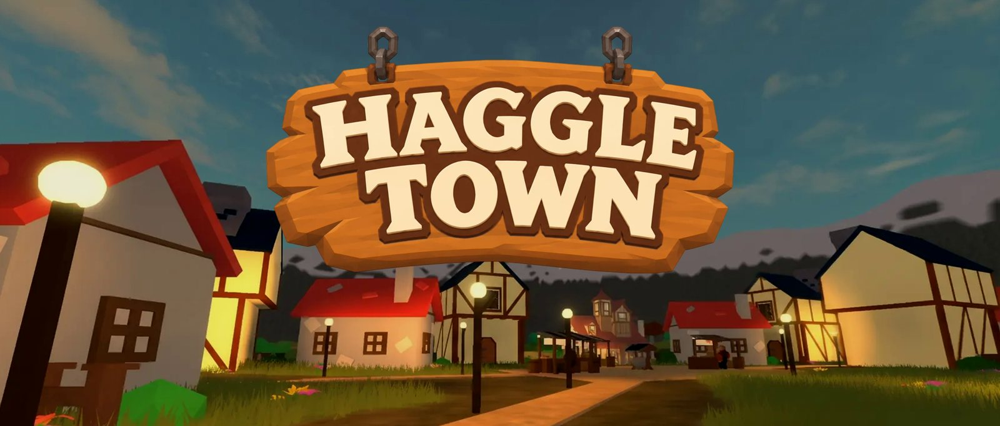
</p>

<h1 align="center">Haggle Town</h1>

<p align="center">
  <b>A Roblox market town where the shopkeepers are AI agents with their own NEAR accounts.<br>
  You haggle with them in plain chat. They can bluff, sulk and walk away. They cannot break the price rules, because the contract won't let them.</b>
</p>

<p align="center">
  <a href="https://www.roblox.com/games/87878138386141/Haggle-Town">Play on Roblox</a> ·
  <a href="https://x.com/woydarko/status/2121681819477422418">Demo video</a> ·
  <a href="https://backend-production-fccb03fb.up.railway.app">Website</a> ·
  <a href="https://backend-production-fccb03fb.up.railway.app/app/">Live dashboard</a> ·
  <a href="https://testnet.nearblocks.io/address/haggletown-v2.testnet">Contract on nearblocks</a> ·
  <a href="https://testnet.nearblocks.io/txns/FLb7YA38r3r1ESFuHoapirMX5bFsbGteK8mTVfVgN2zN">The refused deal</a>
</p>

<p align="center">
  NEAR HACKATHON · <b>Games With Real Economies</b> (main) · <b>Agent Economy</b> · <b>Memecoins With Mechanics</b>
</p>

---

## The 60-second version

**The problem.** A shop in a game is a price table that somebody typed in. Players find the one item worth farming, sell it a thousand times, and the economy tips over until a developer patches the numbers. Games that try to put a real economy on a blockchain usually make it worse in a different way: before you can play, you meet a wallet, a seed phrase and a gas fee.

**What we built.** Haggle Town gives every shop a mind and a purse. Three merchants (the Woodcutter, the Fishmonger and the Smith) each run as an AI agent with its own NEAR testnet account, its own Coin and its own stock. Players gather wood, fish and ore with short minigames, then walk up to a stall and type an offer in their own words. The merchant answers in character and counters with a price that comes from its real stock and its real purse. If you accept, the deal is signed by that merchant's key and settled on chain. Prices follow supply and demand on their own, so nobody patches anything.

**Why it holds up.** The model is allowed to talk, not to decide. Every price the AI proposes is pulled back into a room computed from one rules file, and the contract checks the same room again at settle time. A deal the merchant really signed, at a price outside the rules, is refused on chain. [Here it is](https://testnet.nearblocks.io/txns/FLb7YA38r3r1ESFuHoapirMX5bFsbGteK8mTVfVgN2zN): the Woodcutter signing pine for 1 coin, rejected with `PriceOutOfRoom`.

**What the player sees.** A cozy village, three stubborn shopkeepers and a currency called Coin. No wallet, no seed phrase, no popup, no chain words anywhere inside Roblox. Coin can never be exchanged for Robux or money.

## Screenshots

**In the game**

<table>
  <tr>
    <td width="50%">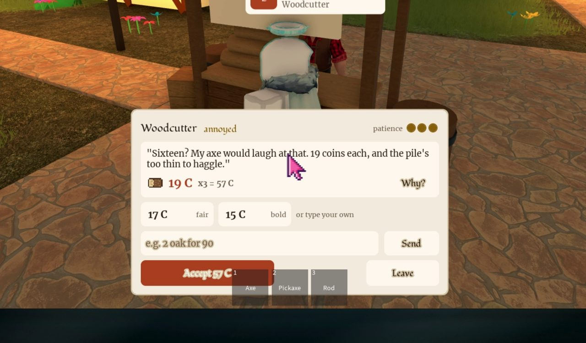</td>
    <td width="50%">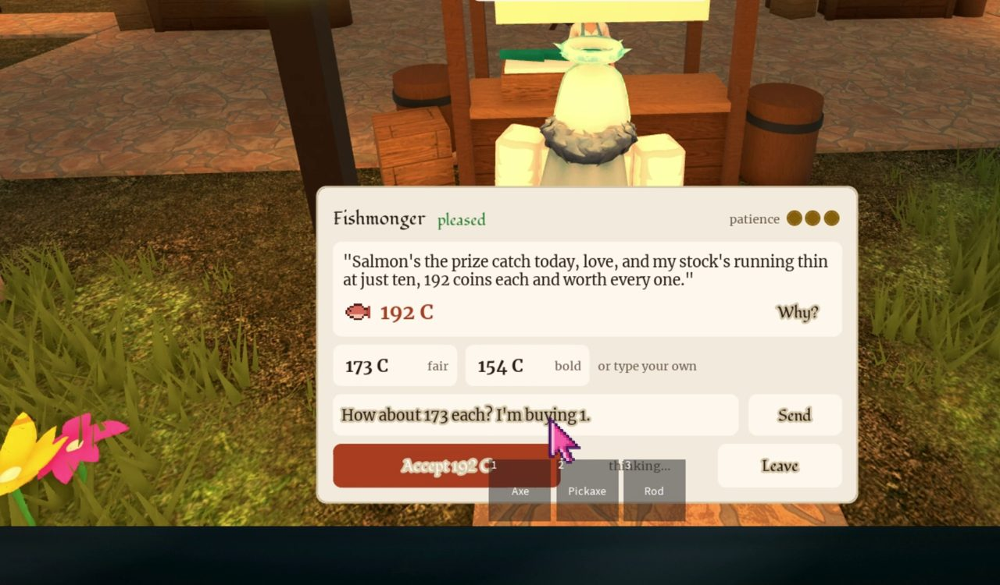</td>
  </tr>
  <tr>
    <td>Lowball the Woodcutter and he gets annoyed. Three lowballs in a day and he stops talking to you until tomorrow (the three dots are his patience).</td>
    <td>The Fishmonger holds her price because her salmon stock is low. The counter comes from stock and purse, not from the model's mood.</td>
  </tr>
  <tr>
    <td>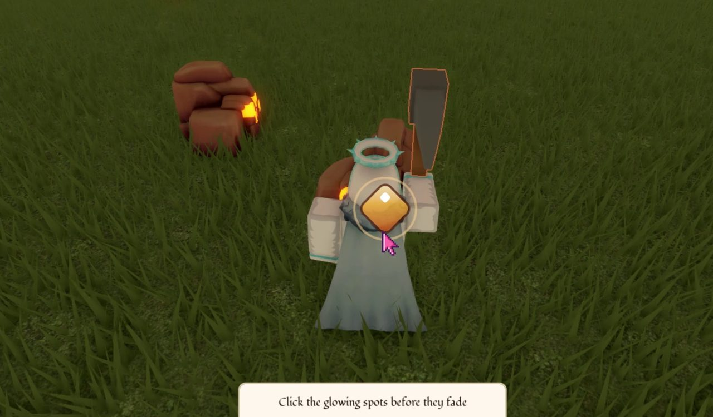</td>
    <td>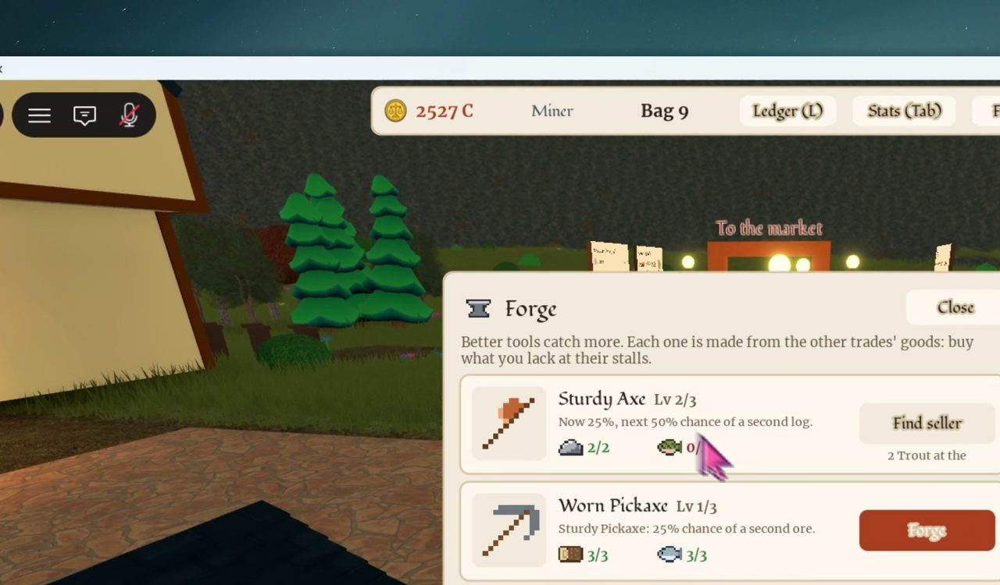</td>
  </tr>
  <tr>
    <td>Gathering is a short minigame per tree, rock or fishing spot. Better play rolls better tiers.</td>
    <td>Tools are forged from the other trades' goods, so a Logger has to buy from the Smith and the Fishmonger.</td>
  </tr>
  <tr>
    <td>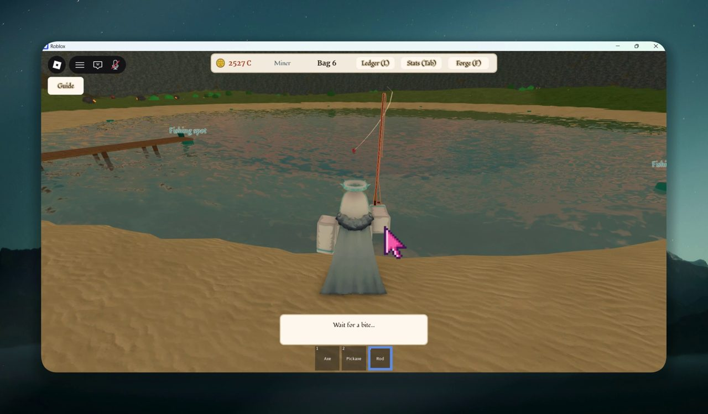</td>
    <td>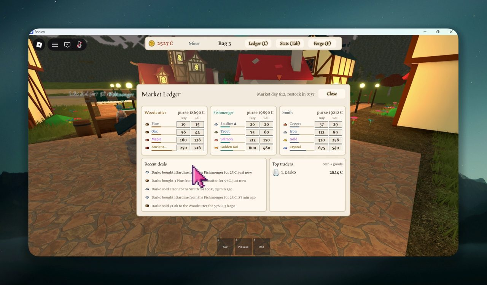</td>
  </tr>
  <tr>
    <td>The valley has woods, a mine and a lake. Each trade has its own spot and its own merchant.</td>
    <td>The Market Ledger inside the game reads the same live prices and recent deals as the website.</td>
  </tr>
</table>

**On the website** (the on-chain side, which players never need to visit)

<table>
  <tr>
    <td width="50%">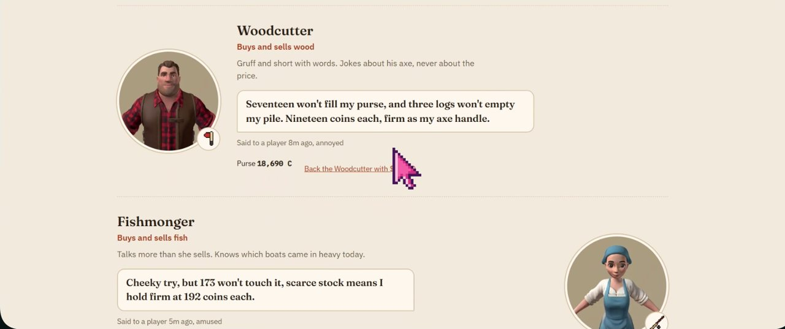</td>
    <td width="50%">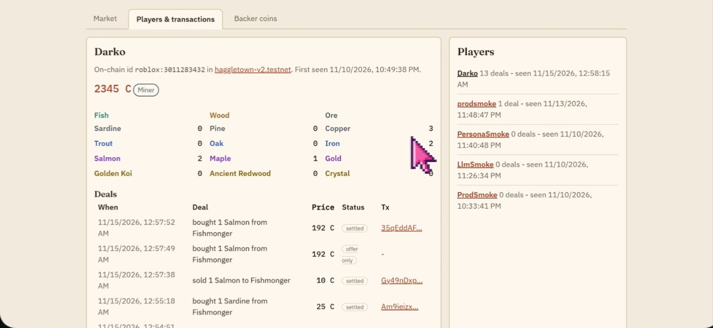</td>
  </tr>
  <tr>
    <td>The landing page quotes the last thing each merchant actually said to a player.</td>
    <td>Every player has a page with their goods, their Coin and every deal, each linked to its transaction.</td>
  </tr>
  <tr>
    <td>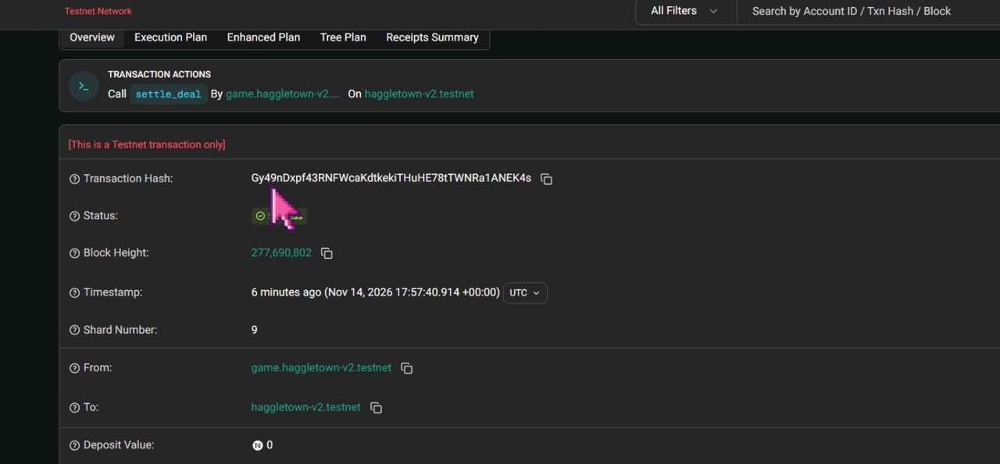</td>
    <td>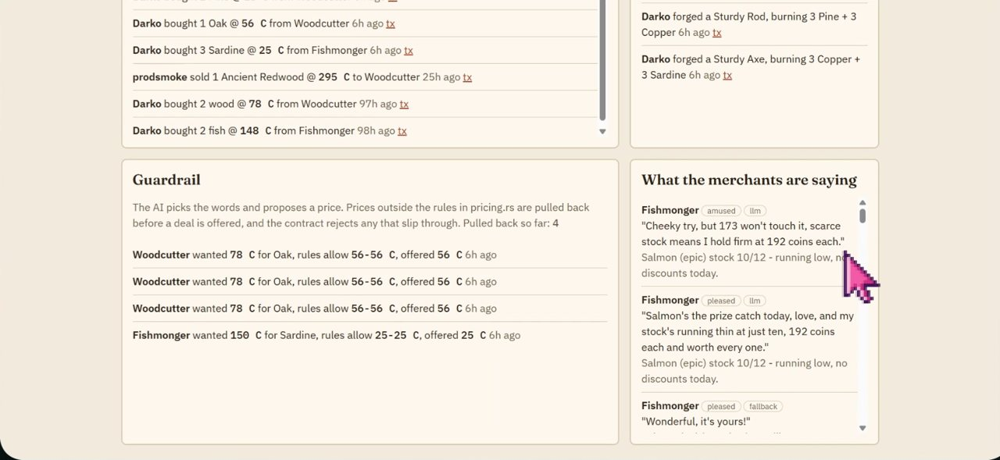</td>
  </tr>
  <tr>
    <td>A deal from the game, settled by <code>settle_deal</code> on <code>haggletown-v2.testnet</code>.</td>
    <td>The Guardrail panel logs every time the AI wanted a price outside the rules and what it was allowed to offer instead.</td>
  </tr>
  <tr>
    <td>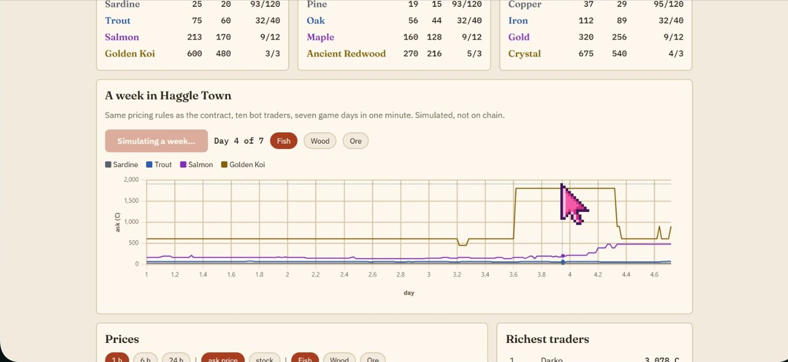</td>
    <td>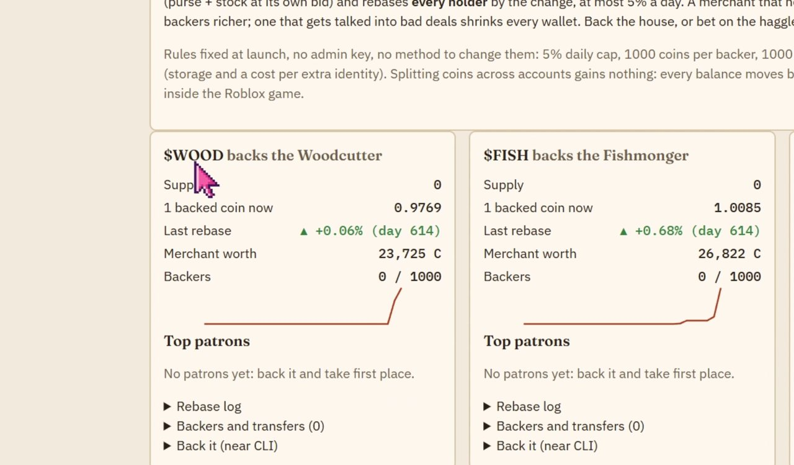</td>
  </tr>
  <tr>
    <td>Replay a simulated week to watch prices move with nobody patching them.</td>
    <td>$WOOD, $FISH and $SMITH: one memecoin per merchant, rebased on that merchant's on-chain worth.</td>
  </tr>
</table>

## One deal, start to finish

The player types; the model talks; the rules and the contract decide. Every arrow below exists in the code.

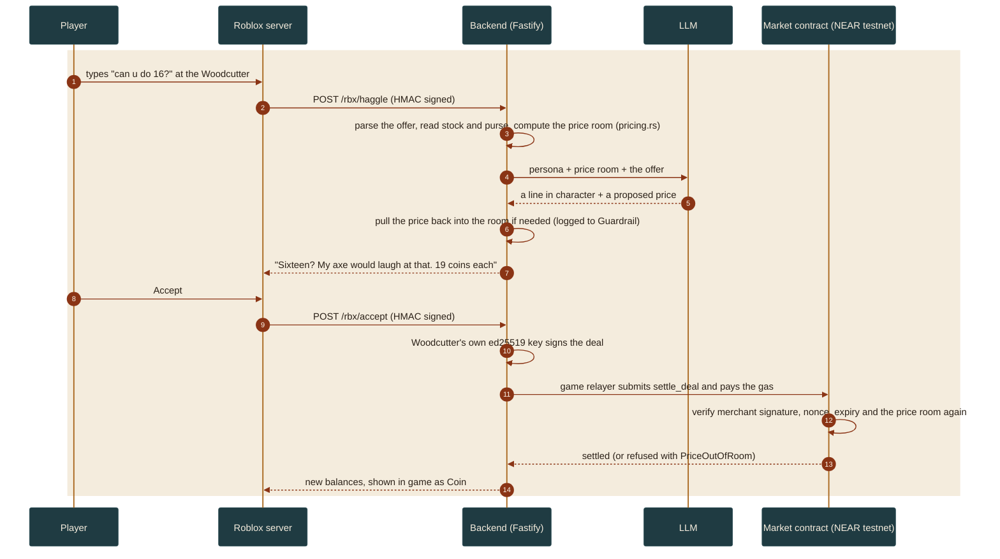

## Architecture

Three trust boundaries: the Roblox server can only ask, the backend holds the keys, and the contract has the last word on every price.

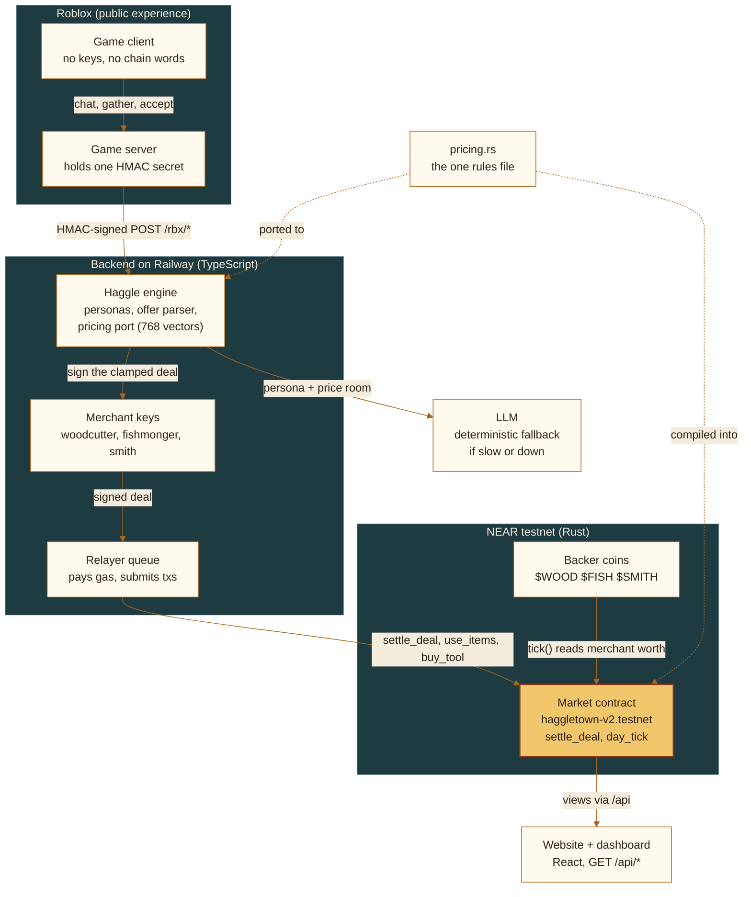

- **Players are not accounts.** A player is a contract-internal id (`roblox:<UserId>`). One game relayer account pays every fee, so nobody has to own NEAR to play.
- **Merchants are accounts.** `woodcutter`, `fishmonger` and `smith` are sub-accounts of `haggletown-v2.testnet`. The contract only settles a deal carrying that merchant's registered ed25519 signature.
- **The Roblox server never holds a NEAR key.** It holds one HMAC secret in `ServerStorage` and can only ask the backend for things a player is allowed to do.
- **The game never stalls.** If the LLM is slow or down, a deterministic merchant with the same personas answers instead, inside the same price room.

## What makes it different

**1. The AI talks. The contract decides.**
Most "AI agent with a wallet" demos trust the model with the money. Here the money is guarded three times: the backend computes the allowed room from `economy/src/pricing.rs`, clamps whatever the model proposed and logs it on the Guardrail panel; the merchant signs only the clamped deal; and `settle_deal` recomputes the room on chain and refuses anything outside it, signature or not. The rules only protect the merchant. If you sell below its bid or pay above its ask, it happily takes your money, so haggling badly has a real cost.

**2. One rules file, three runtimes.**
`economy/src/pricing.rs` is the single source of every price: ask = base × target / stock, clamped to 0.5 to 3 times base, bid at 80% of ask, up to 40% off when overstocked and up to 40% extra when short. The contract compiles it, the simulator runs it, and the backend runs a TypeScript port that is tested against 768 price vectors generated by the Rust code. A bug cannot make the game and the chain disagree about a price without a test failing.

**3. An economy that closes its own loop.**
Every 5-minute game day, `day_tick` restocks each merchant toward its target and burns some stock. Tools are forged from the other two trades' goods, and the goods used are burned on chain (`use_items`), so a Logger needs the Smith and the Fishmonger. New tools bought from another trade cost 150 C paid to that trade's merchant, which refills its purse. A merchant whose purse runs dry stops buying until players buy from it.

**4. A chain you never see.**
Inside Roblox there is no wallet, no signature prompt and no chain vocabulary at all, only Coin. That was a hard requirement, both for players and for Roblox's rules: Coin can never be traded for Robux or money, and everything runs on testnet.

**5. Memecoins that measure the agents.**
`$WOOD`, `$FISH` and `$SMITH` are NEP-141 coins, one per merchant. Once per market day anyone can call `tick()`: the coin reads its merchant's net worth (purse plus stock at its own bid) straight from the market contract and rebases every holder by the change, capped at 5% a day (the cap was picked with a 60-day simulation). A merchant that holds its prices against clever hagglers makes its backers richer; one that gets talked into bad deals shrinks every wallet. There is no admin method and the coin accounts have no keys left.

## How each track is covered

| Track | What to look at | Where |
| --- | --- | --- |
| **Games With Real Economies** | A public Roblox game with a real gather, haggle and forge loop. Prices move with supply and demand, merchants restock daily, forged goods are burned. Chain fully hidden from players. | [Play](https://www.roblox.com/games/87878138386141/Haggle-Town), `economy/`, `contract/src/deals.rs`, `roblox/` |
| **Agent Economy** | Three AI agents, each with its own account, Coin and stock, negotiating in character, signing their own deals, kept inside a policy that the contract enforces. | [Refused signed deal](https://testnet.nearblocks.io/txns/FLb7YA38r3r1ESFuHoapirMX5bFsbGteK8mTVfVgN2zN), `server/src/haggle/`, Guardrail panel on the [dashboard](https://backend-production-fccb03fb.up.railway.app/app/) |
| **Memecoins With Mechanics** | One coin per merchant whose supply follows that agent's on-chain performance, permissionless `tick()`, 5% daily cap, no admin. | `coin/`, [docs/hackathon/MEMECOIN.md](docs/hackathon/MEMECOIN.md), dashboard tab "Backer coins" |

### The merchants as agents, honestly

| What an agent economy asks for | Haggle Town today |
| --- | --- |
| An agent with its own wallet that earns and spends | Each merchant has its own NEAR account, holds Coin and stock in the market contract, buys from and sells to players, and signs every deal with its own key. |
| Negotiation: counter with reasons, accept or walk away | The merchant counters in character, explains itself on the "Why?" button, accepts offers inside its room, and walks away after three lowballs in a day. |
| Spending stays inside a policy | The price room is the policy. The backend pulls the model back into it and the contract refuses anything outside it, even when signed. |
| A receipt for every task | Every deal, forge burn and tool purchase is a transaction, listed on the dashboard with the merchant's line and reasoning. |
| Hiring other agents, paying for APIs, NEAR Intents | **Not built yet.** Merchants trade only with players and the backend pays the model. Next step: merchant-to-merchant restock deals signed by both agents, and paying the model per call from the merchant's own purse. |

## Verify it yourself

**On chain, no setup needed**
- Market contract: [`haggletown-v2.testnet`](https://testnet.nearblocks.io/address/haggletown-v2.testnet)
- A deal the Woodcutter signed at an illegal price, refused with `PriceOutOfRoom`: [FLb7YA38…](https://testnet.nearblocks.io/txns/FLb7YA38r3r1ESFuHoapirMX5bFsbGteK8mTVfVgN2zN). Reproduce it with `server/scripts/guardrail-proof.ts`.
- Every settled deal, with its transaction link: the [dashboard](https://backend-production-fccb03fb.up.railway.app/app/#/players).

**The code, no keys needed**

```bash
cargo test -p economy -p haggle-contract -p haggle-coin   # pricing rules, market contract, backer coin: 65 tests
cd server && npm ci && NODE_ENV=test npm test             # backend: 147 tests, incl. the 768 pricing vectors
cd web && npm ci && npm test && npm run build              # website helpers (6 tests) + both pages
cargo run -p sim -- --days 7 --bots 10 --seed 42 --out web/public/sim/week.json   # the fast-forward week
```

All of the above were run on 2026-11-15 and pass. Running the full backend needs NEAR testnet keys: `scripts/deploy.sh` and `scripts/seed.sh` create the accounts and fill `.env` from `.env.example`, then `cd server && npm start`. For the Roblox place, `bash scripts/roblox-local.sh` builds `roblox/build-local.rbxl` for Studio (needs Rojo).

## The game loop in detail

- **30 seconds:** walk to a tree, rock or fishing spot and play the minigame. Catches roll a tier (common, rare, epic, legendary, worth 1, 3, 8 and 30 times base), and better play shifts the odds.
- **5 minutes:** take your goods to the Woodcutter, the Fishmonger or the Smith and type an offer in any words ("I'll give 40 for 5 iron"). The merchant counters in character. Accept, and the deal settles on chain in the background.
- **Trades:** at the guild you pick Logger, Miner or Fisher. Your trade's tool is free, and you get a better sell room on your own goods. Switching costs 100 C and only once every 5 minutes.
- **Forge:** upgrade your Axe, Pickaxe or Rod from Worn to Sturdy to Master for a 25% or 50% chance of a second item per catch. Recipes always use the other two trades' goods (axe: copper and sardine; pickaxe: pine and sardine; rod: pine and copper; Master adds iron, oak and trout). The haggle panel's Buy tab marks what your forge still needs.
- **Longer run:** climb the richest-traders board. Each game day merchants restock toward their target and use up stock, prices drift, and a broke merchant stops buying until someone buys from it.

## Honest limits

- **Custody.** In this hackathon build, all three merchant keys live as environment variables on one backend, so the separation is per key, not per machine. The production path is for each merchant to sign inside its own TEE or through NEAR chain signatures. The contract-side rules would not change.
- **Testnet only.** Coin and the backer coins have no real-world value, by design.
- **Not built:** agent-to-agent trading, paying for the model from a merchant's purse, NEAR Intents.

## Repository map

| Path | What lives there |
| --- | --- |
| `economy/` | `pricing.rs`, tiers and drop odds: the one rules file, plus the test vectors |
| `contract/` | Market contract: NEP-245 items, merchants, `settle_deal`, `day_tick`, `use_items`, `buy_tool`, classes |
| `coin/` | Backer coin: NEP-141 memecoin that rebases on its merchant's on-chain worth |
| `server/` | Backend: Roblox API (HMAC), haggle engine, LLM client and fallback, relayer queue, website API |
| `web/` | Landing page at `/` and the dashboard at `/app/` (React, Vite) |
| `roblox/` | The Roblox place (Luau, Rojo) |
| `sim/` | Simulator on the same pricing crate (fast-forward week, Forge comparison, 60-day coin scenarios) |
| `docs/` | PRD, architecture, security, design specs, plans and the antislop audit of the website |

## AI tools and third-party code

- Code written with **Claude Code** (Anthropic) as a pair programmer. Designs, plans and reviews are in `docs/superpowers/`.
- Merchant dialogue at runtime comes from an OpenAI-compatible LLM (`deepseek-v4.1-flash` through a gateway, about 0.5 to 0.9 s per reply), evaluated with `server/eval/`.
- The logo and coin art were made by the author with an AI image tool; the in-game coin icon came from ForgeGUI. Trees, rocks and houses come from the Roblox Creator Store (see `roblox/ASSETS.md`). Merchant portraits on the website are captures of the in-game models.
- Libraries: near-sdk 5.30 (Rust), near-api-js 7, Fastify 5 (+ rate-limit, static), React 19, Vite 8, uPlot, TypeScript 7, ed25519-dalek (tests), Rojo.

## Roblox policy

Coin cannot be exchanged for Robux or money. Testnet only. No crypto wording inside the experience.

## License

MIT, see `LICENSE`.
